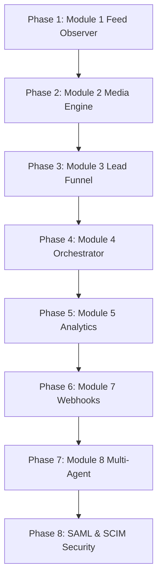

# Project Wolf — Service Implementation Roadmap

Based on [`f:\Project Wolf\SOFTWARE_SPECIFICATION.md`](f:\Project Wolf\SOFTWARE_SPECIFICATION.md). **All phases below are implemented** in the `services/` tree (local Redis/Qdrant fallbacks where infra is absent).

---

## Status Summary

| Phase | Module | Target File | Status |
| :--- | :--- | :--- | :--- |
| 1 | Feed Observer | `module_1_feed_observer/observer.py` + `gemini_bridge.py` | Done |
| 2 | Media Engine | `module_2_media_engine/media_processor.py` | Done |
| 3 | Lead Funnel | `module_3_lead_funnel/fb_automation_module3.py` | Done |
| 4 | Orchestrator | `module_4_orchestrator/dispatcher.py` + `celery_app.py` | Done |
| 5 | Analytics | `module_5_analytics/telemetry.py` | Done |
| 6 | Webhooks | `module_7_webhooks/webhook_router.py` | Done |
| 7 | Multi-Agent | `module_8_multi_agent/agent_orchestrator.py` | Done |
| 8 | SAML/SCIM | `security_governance/saml_gateway.py` + `scim_router.py` | Done |

### Phase notes
* **M1:** Facebook URL → screenshot → Gemini Web best comment → react/comment; Bezier + human delays.
* **M2:** Aspect validation, dual-stage captions, Graph publish (dry-run default), group shares, hooks.
* **M3:** Comment→DM + Spintax, fatigue pause, **+15% budget auto-scale** on 48h ROAS, 14-day warm-up caps.
* **M4:** Redis token bucket + Redlock (in-memory fallback), Celery, jittered backoff + DLQ.
* **M5:** Sa, CPL, metering ledger, all four circuit breakers wired through `safety_bridge`.
* **M7:** HMAC `X-Signature-SHA256`, 5-window retry + DLQ, OAuth scopes.
* **M8:** LangGraph DAG (sequential fallback), agents + Qdrant/in-memory RAG, self-healing.
* **Security:** SAML Jackson proxy or local JWT ACS; SCIM Users CRUD with soft-delete.
