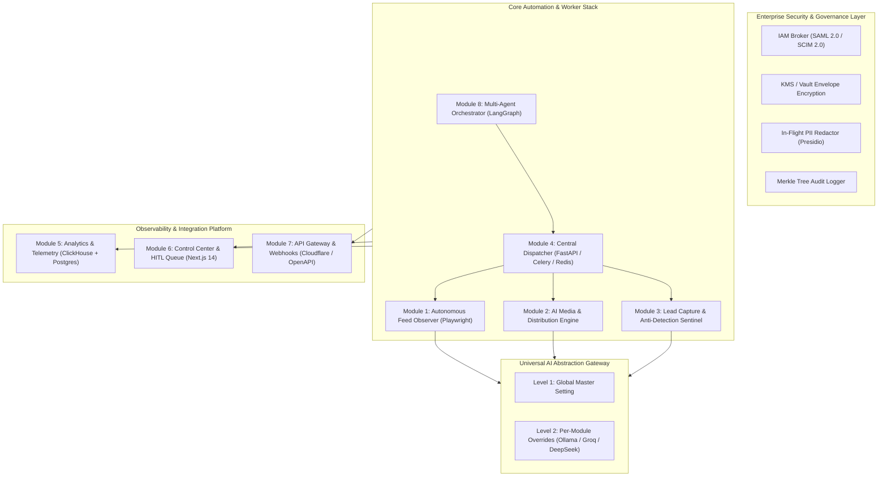

# The-Wolf-Suite-Test-Version
Enterprise Level Social Platforms Automation Network

# Wolf Suite — Enterprise Autonomous Social Media & Multi-Agent Platform

**Wolf Suite** is an enterprise-grade autonomous social media automation, lead generation, and multi-agent orchestration platform built according to the 10 core architectural specifications.

## System Architecture Overview

```
+-----------------------------------------------------------------------------------+
|                        ENTERPRISE GOVERNANCE & SECURITY                           |
|      BoxyHQ SAML 2.0 | SCIM 2.0 | Presidio PII Redaction | Merkle Audit Trail       |
+-----------------------------------------------------------------------------------+
|                            UNIVERSAL AI GATEWAY                                   |
|      OpenAI REST Schema | Global Master Key | Per-Module Provider Overrides       |
+-----------------------------------------------------------------------------------+
|                          CORE AUTOMATION STACK                                    |
|  +------------------------+  +------------------------+  +---------------------+  |
|  | Module 1: Feed Observer|  | Module 2: Media Engine |  | Module 3: Lead/DM   |  |
|  | (Chromium/Playwright)  |  | (Dual-Stage AI Media)  |  | (Meta Graph / Ads)  |  |
|  +------------------------+  +------------------------+  +---------------------+  |
|                                         ^                                         |
|  +--------------------------------------+--------------------------------------+  |
|  | Module 4: Central Orchestration (FastAPI / Celery / Redis Rate Limiter)     |  |
|  +-----------------------------------------------------------------------------+  |
|  | Module 8: Multi-Agent Orchestration (LangGraph / Qdrant RAG / Self-Healing)  |  |
|  +-----------------------------------------------------------------------------+  |
+-----------------------------------------------------------------------------------+
|                          PLATFORM & OBSERVABILITY                                 |
|  +-----------------------+  +-----------------------+  +-----------------------+  |
|  | Module 5: Observability|  | Module 6: Next.js 14  |  | Module 7: API Gateway |  |
|  | (ClickHouse/Postgres) |  | (HITL Control Center) |  | (Cloudflare/Webhooks) |  |
|  +-----------------------+  +-----------------------+  +-----------------------+  |
+-----------------------------------------------------------------------------------+
```

## System Modules

* **Module 1**: Autonomous Feed Observer & Engagement Agent (Playwright, Vision AI, Human-Mimicking Bezier Cursors & Typing Cadence)
* **Module 2**: AI Media Processing, Multi-Platform Distribution & Engagement Engine (Dual-Stage Gemini AI, FB/IG/Threads Publishing)
* **Module 3**: Lead Capture, Conversational Messenger Funnels & Anti-Detection Sentinel (Comment-to-DM, Spintax, Ad Fatigue Guard)
* **Module 4**: Central Orchestration, Task Scheduling & Distributed Worker Architecture (FastAPI, Celery, Redis Token Bucket, Redlock)
* **Module 5**: Unified Analytics, System Observability & AI Telemetry (ClickHouse OLAP, Postgres OLTP, Safety Score $S_a$, Cost Metering)
* **Module 6**: Multi-Tenant Control Center, Security Governance & HITL Workflows (Next.js 14, RLS, Envelope Encryption, Kill-Switches)
* **Module 7**: External Ecosystem Integration, Webhook Gateways & Developer Platform (HMAC SHA-256, Exponential Retries, DLQ)
* **Module 8**: Autonomous Multi-Agent Orchestration & Self-Healing Engine (LangGraph State Machine, Vector RAG Memory, Pivot Loops)
* **Enterprise Security**: SAML 2.0 SSO, SCIM 2.0 Provisioning, Presidio PII Redactor, Merkle Audit Trails.
* **Universal AI Gateway**: OpenAI REST Schema Compatible (`/v1/chat/completions`) with Global & Per-Module Overrides.

## Quick Start

```bash
# 1) Infrastructure
docker compose up -d

# 2) Python deps
pip install -r requirements.txt

# 3) Apply DB schema
psql $DATABASE_URL -f db/schema.sql

# 4) Smoke integration (Modules 4↔5↔6 + KMS + Audit)
python scripts/smoke_integration.py

# 5) Unified API
uvicorn main:app --reload --port 8080

# 6) Control Center UI
cd apps/control_center && npm install && npm run dev
```

## Integration Wiring (Current)

* **Module 5 → Module 6:** CAPTCHA circuit breakers auto-issue Level 1 account kill-switches
* **Module 4 → Module 6:** Every dispatch checks kill-switch gate before rate-limit / Redlock
* **All safety events → Merkle Audit:** Hash-chained SIEM-ready audit trail
* **Unified API:** `main.py` mounts orchestrator, governance, webhooks, SAML, SCIM

## Repository Structure

```
f:\Project Wolf
├── apps/
│   └── control_center/          # Module 6: Next.js 14 Control Center (HITL / Kill-Switch UI)
├── db/
│   └── schema.sql               # PostgreSQL multi-tenant schema
├── scripts/
│   └── smoke_integration.py     # Cross-module smoke tests
├── main.py                      # Unified FastAPI entrypoint
├── services/
│   ├── ai_gateway/              # Universal AI Abstraction Gateway
│   ├── module_1_feed_observer/  # Module 1: Browser Automation & Feed Observer
│   ├── module_2_media_engine/   # Module 2: AI Media Synthesis & Multi-Platform Publisher
│   ├── module_3_lead_funnel/    # Module 3: Comment-to-DM, Spintax & Ad Guard
│   ├── module_4_orchestrator/   # Module 4: FastAPI Dispatcher & Celery Worker Pool
│   ├── module_5_analytics/      # Module 5: Telemetry, Safety Score & Cost Metering
│   ├── module_7_webhooks/       # Module 7: Webhook Gateway & Developer Portal
│   ├── module_8_multi_agent/    # Module 8: LangGraph Multi-Agent Orchestrator
│   └── security_governance/     # Enterprise SAML, SCIM, PII Redactor & KMS
├── docker-compose.yml           # Infrastructure Stack (Postgres, ClickHouse, Redis, Qdrant)
├── requirements.txt             # Global Python Dependencies
└── .env.example                 # Master Configuration Template
```


# Wolf Suite — Enterprise Autonomous Social Media & Multi-Agent Platform
## Comprehensive Software Architecture Specification & Technical Blueprint

**Product Name:** Wolf Suite  
**Document ID:** SPEC-2026-WOLF-MASTER  
**Version:** 2.0  
**Classification:** Confidential / Enterprise System Architecture  
**Target Platform:** Multi-Tenant Web, Cloud & Distributed Automation Stack  

---

## Table of Contents

1. [Executive Summary & System Vision](#1-executive-summary--system-vision)
2. [Master System Architecture Diagram](#2-master-system-architecture-diagram)
3. [Module 1: Autonomous Feed Observer & Engagement Agent](#3-module-1-autonomous-feed-observer--engagement-agent)
4. [Module 2: AI Media Processing, Multi-Platform Distribution & Engagement Engine](#4-module-2-ai-media-processing-multi-platform-distribution--engagement-engine)
5. [Module 3: Lead Capture, Conversational Funnels & Anti-Detection Sentinel](#5-module-3-lead-capture-conversational-funnels--anti-detection-sentinel)
6. [Module 4: Central Orchestration, Task Scheduling & Distributed Worker Architecture](#6-module-4-central-orchestration-task-scheduling--distributed-worker-architecture)
7. [Module 5: Unified Analytics, System Observability & AI Telemetry Architecture](#7-module-5-unified-analytics-system-observability--ai-telemetry-architecture)
8. [Module 6: Multi-Tenant Control Center, Governance & HITL Workflows](#8-module-6-multi-tenant-control-center-governance--hitl-workflows)
9. [Module 7: External Ecosystem Integration, Webhook Gateways & Developer Platform](#9-module-7-external-ecosystem-integration-webhook-gateways--developer-platform)
10. [Module 8: Multi-Agent Orchestration, Cognitive Planning & Self-Healing Engine](#10-module-8-multi-agent-orchestration-cognitive-planning--self-healing-engine)
11. [Enterprise Security, Identity & Compliance Specification](#11-enterprise-security-identity--compliance-specification)
12. [Universal AI Abstraction Gateway & Key Management Hierarchy](#12-universal-ai-abstraction-gateway--key-management-hierarchy)
13. [Database Schemas & Data Model Specifications](#13-database-schemas--data-model-specifications)
14. [Target Technical File Architecture](#14-target-technical-file-architecture)

---

## 1. Executive Summary & System Vision

**Project Wolf** is an enterprise-grade, multi-tenant software system designed for autonomous social media intelligence, virality distribution, conversational lead conversion, and self-healing multi-agent execution across Facebook, Instagram, and Threads.

The platform eliminates single points of failure, account bans, and AI provider lock-in through five architectural pillars:
1. **Human-Mimicking Browser Mechanics:** Bezier mouse trajectories, Gaussian keystroke cadences, visual dwell heuristics, and hardware-level DOM dispatches.
2. **Dual-Stage Multimodal AI Engine:** Vision-based post analysis, engagement scoring, and virality caption selection.
3. **Asynchronous Distributed Orchestration:** FastAPI, Celery, Redis Token Bucket rate limiting, and Redlock distributed state machines.
4. **Zero-Trust Enterprise Governance:** SAML 2.0 / SCIM 2.0 IAM, in-flight Presidio PII redaction, envelope encryption (AES-256-GCM), and append-only Merkle tree audit logging.
5. **Universal OpenAI-Compatible AI Gateway:** Flexible routing supporting global master providers and per-module open-source/self-hosted LLM overrides (Ollama, Groq, DeepSeek, vLLM).

---

## 2. Master System Architecture Diagram



---

## 3. Module 1: Autonomous Feed Observer & Engagement Agent

### 3.1 Detailed Operational Execution Pipeline (Refined)

```
[ Step 1: Facebook Navigation via URL ]
            │
            ▼
[ Step 2: Post Capture — first post/video screenshot on home feed ]
            │
            ▼
[ Step 3: Gemini Web Analysis — upload screenshot → single best comment ]
            │
            ▼
[ Step 4: Engagement — react + paste/type comment on the post ]
            │
            ▼
[ Step 5: Human-like Automation — Bezier cursor + natural delays ] ➔ Loop
```

* **Step 1: Facebook Navigation:** Opens Facebook via `FB_HOME_URL` (default `https://www.facebook.com`) using a persistent Chromium profile. Auth / CAPTCHA / 2FA challenges enter an Idle Wait Loop for human intervention.
* **Step 2: Post Capture:** Locates the first visible feed post or video, centers it, applies reading dwell, and captures a high-resolution screenshot held in volatile memory.
* **Step 3: Gemini Analysis (Web-first):** Uploads/pastes the screenshot into `gemini.google.com` and prompts for the **single best short natural comment**. Optional structured JSON mode (`GEMINI_STRUCTURED_JSON`) may also return a reaction. API / OpenAI-compatible vision is a fallback when `GEMINI_MODE=api|both`.
* **Step 4: Engagement Execution:** Returns to the Facebook tab, reacts (LIKE/LOVE/CARE/HAHA/WOW), then pastes or human-types the generated comment into the post comment box.
* **Step 5: Human-like Automation:** Cubic Bezier mouse paths, Gaussian keystroke cadences, punctuation pauses, backspace corrections, reflection pauses, and organic scroll between posts.

### 3.2 Anti-Detection & Humanizing Mechanics

| Mechanism | Expanded Technical Implementation Detail |
| :--- | :--- |
| **Mouse Trajectories** | Generates non-linear Cubic Bezier curves with pseudo-random control offsets and velocity curves to simulate physical hand inertia. |
| **Keystroke Timing** | Uses Gaussian-distributed delay intervals (~80ms to 220ms per character) combined with dynamic pauses at punctuation marks and simulated backspace corrections. |
| **Dwell & Idle Simulation** | Calculates variable reading delays scaled directly to image complexity and word count prior to executing actions. |
| **DOM Interactions** | Prioritizes genuine hardware-level event dispatches (`mousemove`, `click`, `keydown`) over raw JavaScript property overrides to prevent anti-bot flags. |

---

## 4. Module 2: AI Media Processing, Multi-Platform Distribution & Engagement Engine

### 4.1 5-Phase Execution Matrix

| Phase | Stage Name | Operational Summary & Technical Blueprint |
| :--- | :--- | :--- |
| **Phase 1** | Media Ingestion & Validation | Accepts `.jpg`, `.png`, `.mp4`, `.mov`. Validates aspect ratios (1:1 feed, 9:16 vertical/reels, 16:9 landscape) and compresses media if required by destination platform APIs. |
| **Phase 2** | Dual-Stage Gemini AI Processing | **Stage 1:** Generates 3–5 caption variations & hashtag blocks from visual assets.<br>**Stage 2:** Re-evaluates candidates against engagement potential and CTA strength, returning exactly 1 single best description. |
| **Phase 3** | Multi-Platform Publishing | Cross-posts to Facebook, Instagram, and Threads with optional @mentions, visual tags, co-authorship collaborator requests, and highlight flags. |
| **Phase 4** | Post-Publishing Distribution | Collects joined Facebook groups and shares the live post URL one-by-one with randomized delays (45–120s) alongside direct message / Messenger amplification. |
| **Phase 5** | Engagement & Dynamic Hooks | Pins post to profile Story Highlights, submits an initial seed comment, and prompts Gemini for 5 high-converting discussion hooks to automate viewer replies. |

---

## 5. Module 3: Lead Capture, Conversational Funnels & Anti-Detection Sentinel

### 5.1 System Architecture & Information Flow

```
+-----------------------------------------------+
|         Facebook Inbound Touchpoints          |
|         (Comments, DMs, Lead Forms)           |
+-----------------------+-----------------------+
                        |
                        v
+-----------------------+-----------------------+
|        Safety & Proxy Sentinel Layer          |
| (DOM Mimic, Micro-delays, Rate Limits, Spintax)|
+-----------------------+-----------------------+
                        |
           +------------+------------+
           |                         |
           v                         v
+-----------------------+ +-----------------------+
| Dynamic Messenger     | | Ad Campaign Guard     |
| Funnel (NLP Lead      | | (Creative Fatigue &   |
| Qualification & CRM)  | | Auto-Budget Scale)    |
+-----------+-----------+ +-----------+-----------+
            |                         |
            +------------+------------+
                         |
                         v
+------------------------+----------------------+
|        Central Analytics & CRM Sync           |
|        (HubSpot, Sheets, Slack)               |
+-----------------------------------------------+
```

### 5.2 Functional Specifications
1. **Comment-to-DM Trigger Engine:** Matches trigger keywords (`"pricing"`, `"send link"`, `"info"`) in post comments, executing a dual-action response:
   * *Private Outreach:* Dispatches a Meta Graph API message (`/me/messages`) containing the structured lead magnet link directly to the user's inbox.
   * *Public Confirmation:* Replies publicly to the comment ID using a randomized Spintax template (`"Hey {name}, just sent the details to your inbox! 📩 Check your messages."`).
2. **Anti-Detection Safety Protocol:** Stochastic Gaussian delays (1.5s to 5.5s), Spintax template rotation, and a 14-day warm-up throttling curve.
3. **Ad Creative Fatigue Guard:** Queries Meta Insights API hourly (`/insights`).
   * *Fatigue Rule:* Automatically pauses ad if **Frequency > 3.5** AND **CTR < 1.0%**.
   * *Auto-Scale Rule:* Increases daily budget by **+15%** if 48-hour ROAS exceeds target KPIs.

---

## 6. Module 4: Central Orchestration, Task Scheduling & Distributed Worker Architecture

### 6.1 Infrastructure & Technology Stack
* **Core Service:** Python 3.11+, FastAPI, Celery, APScheduler
* **In-Memory Broker:** Redis 7.0
* **Database:** PostgreSQL 15

| Component | Primary Stack | Operational Role |
| :--- | :--- | :--- |
| **Job Dispatcher** | Celery / Redis | Asynchronously routes priority payloads to target worker pools. |
| **Rate Limiter** | Redis Token Bucket | Tracks and enforces per-account request ceilings and cooling windows. |
| **Distributed Lock** | Redis Redlock | Ensures single-node task execution preventing duplicated engagement. |
| **State Store** | PostgreSQL / Prisma | Stores durable task histories, execution logs, and retry attempts. |

### 6.2 Task Lifecycle & Jittered Exponential Backoff
Task State Machine: `ENQUEUED` ➔ `RUNNING` ➔ `RETRY` ➔ `DLQ` (Dead-Letter Queue) ➔ `COMPLETED`.

Retry calculation formula:
$$\text{Retry\_Delay} = \min\left(\text{Max\_Delay},\, \text{Base\_Delay} \cdot 2^{\text{Attempt\_Count}}\right) + \text{Random\_Jitter}$$

---

## 7. Module 5: Unified Analytics, System Observability & AI Telemetry Architecture

### 7.1 Database Architecture & Telemetry Domains
* **Dual-Store Ingestion:** Non-blocking ingestion via Redis Streams / OpenTelemetry Collector into **ClickHouse** (OLAP time-series for API latencies, proxy performance, token counts) and **PostgreSQL** (OLTP for leads, accounts, campaigns).
* **Account Safety Score ($S_a$):**
  $$S_a = 100 - \left(w_1 \cdot C_{\text{fails}} + w_2 \cdot P_{\text{errors}} + w_3 \cdot R_{\text{throttles}}\right)$$
  *(where $w_1=15.0$ for Captcha failures, $w_2=10.0$ for Proxy errors, $w_3=5.0$ for Rate throttles)*.
* **Unit Economics (Cost Per Lead - CPL):**
  $$\text{CPL} = \frac{\sum \text{LLM Costs} + \sum \text{Proxy Costs} + \sum \text{Infrastructure Costs}}{\text{Total Verified Leads}}$$

### 7.2 Automated Circuit Breakers & Incident Matrix

| Event Trigger | Condition | Automated Action | Alert Channel |
| :--- | :--- | :--- | :--- |
| **Consecutive Challenge** | > 2 Captchas failed in 15m | Pauses profile dispatch in Module 4 | Urgent Telegram Alert |
| **Proxy Pool Failures** | > 20% proxy failure rate | Rotates proxy subnet & throttles pool | Slack Ops Channel |
| **Rate-Limit Threshold** | $\ge 3$ consecutive HTTP 429s | Extends cooling delay window by 200% | Dashboard Incident Log |
| **Token Cost Anomaly** | Single task cost > $2.00 USD | Terminates thread & flags payload | Email / Slack Alert |

---

## 8. Module 6: Multi-Tenant Control Center, Security Governance & HITL Workflows

### 8.1 RBAC Permission Matrix

| Role | Config | Campaigns | HITL Approval | Credential Vault | Emergency Kill-Switch |
| :--- | :--- | :--- | :--- | :--- | :--- |
| **Super Admin** | Full | Full | Full | Full | Global & Tenant Level |
| **Campaign Manager** | No Access | Full | Full | Workspace Level | Tenant Level |
| **HITL Operator** | No Access | View Only | Full | No Access | Tenant Level |
| **Read-Only Viewer** | No Access | View Only | No Access | No Access | No Access |

### 8.2 HITL Routing & Emergency Control Levels
* **HITL Escalation Trigger Rules:** Low AI confidence (<85%), high-intent deals exceeding target values, first-touch outreach to target profiles, or manual escalation requests.
* **Envelope Encryption:** AES-256-GCM envelope encryption for profile cookies, tokens, and proxy credentials using HashiCorp Vault / AWS KMS.
* **3 Emergency Control Levels:**
  * *Level 1:* Account-level pause for a single profile.
  * *Level 2:* Workspace-level campaign pause across a tenant.
  * *Level 3:* Global system freeze issuing instant Pub/Sub kill-signals to Module 4.

---

## 9. Module 7: External Ecosystem Integration, Webhook Gateways & Developer Platform

### 9.1 Webhook Reliability Protocol & OAuth Scopes
* **Security Signature:** Outgoing webhook payloads are signed via SHA-256 HMAC (`X-Signature-SHA256`) using tenant-specific secret keys.
* **Exponential Retry Windows:** 5 attempt windows (30s, 5m, 30m, 2h, 12h) with random jitter for 5xx errors or timeouts (>5,000ms). Failed retries spill over to Dead-Letter Queues (DLQ).
* **OAuth2 Permission Matrix:**

| Scope | Description | Permitted Actions |
| :--- | :--- | :--- |
| `leads:read` | Read lead records | Query captured lead details & conversation logs |
| `leads:write` | Modify lead state | Update lead status, add notes, or change custom fields |
| `campaigns:read` | View campaigns | Fetch active campaigns, execution schedules & stats |
| `campaigns:control` | Pause/Resume campaigns | Trigger or pause campaign dispatchers |
| `webhooks:manage` | Manage endpoints | Create, edit, and re-test outgoing webhook subscriptions |
| `system:admin` | Full system access | Restricted to super-admin integrations |

---

## 10. Module 8: Multi-Agent Orchestration, Cognitive Planning & Self-Healing Engine

### 10.1 Multi-Agent Matrix & Self-Healing Reflection

| Agent Identity | Primary Function | Core Tool Set | Reflection Boundary |
| :--- | :--- | :--- | :--- |
| **Supervisor Orchestrator** | Task graph planning & state dispatch | Graph Checkpointer, Sub-agent router | Verifies task graph state completion |
| **Prospecting Agent** | Lead discovery & ICP enrichment | Search APIs, Module 2 Scraping Tools | Validates lead data hygiene & match score |
| **Copywriter Agent** | Contextual DM & email generation | Module 3 LLM Engine, Brand Voice RAG | Evaluates sentiment & compliance score |
| **Security & Risk Agent** | Safety audit & rate limit inspection | Module 4 Schedule Validator, Proxy Health | Blocks unsafe profile interaction vectors |
| **Self-Healing Agent** | Error analysis & dynamic recovery | Log Inspector, Anti-Detection Switcher | Pivots strategy upon execution failure |

* **Self-Healing Loop:** Captures raw execution error traces, DOM snapshots, and profile states. Classifies errors into **Transient** (network/rate limit), **Technical** (DOM selector shift), or **Security** (CAPTCHA/challenge). Pivots execution vectors (e.g., switches proxy subnet, falls back to API dispatch, or pauses worker to HITL queue).

---

## 11. Enterprise Security, Identity & Compliance Specification

### 11.1 Identity & Access Management (IAM)
* **SAML 2.0 / OIDC Gateway:** IdP Broker using BoxyHQ SAML Jackson decoupling enterprise IdPs (Okta, Entra ID) from internal authorization.
  * *SP Metadata Endpoint:* `https://auth.enterprise.domain/api/v1/sso/saml/metadata`
  * *ACS Endpoint:* `https://auth.enterprise.domain/api/v1/sso/saml/acs`
* **SCIM 2.0 Identity Lifecycle Management (RFC 7643 / 7644):**

| Method | Endpoint | Description |
| :--- | :--- | :--- |
| `GET` | `/scim/v2/Users` | Paginated search & filtering of enterprise users |
| `POST` | `/scim/v2/Users` | Idempotent user creation and role initialization |
| `PATCH` | `/scim/v2/Users/{id}` | Partial updates (e.g., setting `active: false` for immediate lock) |
| `DELETE` | `/scim/v2/Users/{id}` | Soft-deletion trigger initiating compliance retention timelines |

### 11.2 In-Flight PII Redaction & Immutable Audit Log
* **In-Flight PII Engine:** Integrates Microsoft Presidio SDK (`AnalyzerEngine`, `AnonymizerEngine`) to sanitize `PERSON`, `EMAIL_ADDRESS`, `PHONE_NUMBER`, and `CREDIT_CARD` tokens before LLM dispatch or vector embedding.
* **Cryptographically Signed Audit Records:** Serialized append-only structure with Merkle tree HMAC-SHA256 hash chaining exported to Splunk HEC / Datadog over TLS 1.3 with AWS KMS Customer Managed Encryption Keys (CMEK).
* **Disaster Recovery SLAs:** Recovery Point Objective (RPO) < 5 Minutes; Recovery Time Objective (RTO) < 15 Minutes.

---

## 12. Universal AI Abstraction Gateway & Key Management Hierarchy

### 12.1 Provider Abstraction & Inheritance Protocol
All modules interface through a unified OpenAI-compatible REST API endpoint (`/v1/chat/completions`).

```
+-------------------------------------------------------------------+
| LEVEL 1: GLOBAL MASTER SETTING                                     |
| Master API Key, Base URL, and Default Model                       |
+---------------------------------+---------------------------------+
                                  |
         +------------------------+------------------------+
         |                                                 |
         v                                                 v
+---------------------------------+               +---------------------------------+
| LEVEL 2: MODULE OVERRIDE        |               | LEVEL 2: MODULE OVERRIDE        |
| Module 2: Local Ollama          |               | Module 8: DeepSeek / vLLM       |
| (Qwen2.5-VL / Llama-3.2-Vision) |               | (DeepSeek-R1 / Claude 3.5)      |
+---------------------------------+               +---------------------------------+
```

| Module Target | Default Fallback | Sample Open-Source Provider | Key Override Option |
| :--- | :--- | :--- | :--- |
| **Module 2 (DOM & Vision)** | Global Key | Local Ollama (`Qwen2.5-VL` / `Llama-3.2-Vision`) | `MOD2_API_KEY` / `MOD2_BASE_URL` |
| **Module 3 (DM Copywriting)** | Global Key | Groq Cloud Free Tier / `Mistral-7B` | `MOD3_API_KEY` / `MOD3_BASE_URL` |
| **Module 8 (Agent Supervisor)**| Global Key | DeepSeek API / Self-Hosted vLLM (`DeepSeek-R1`) | `MOD8_API_KEY` / `MOD8_BASE_URL` |

---

## 13. Database Schemas & Data Model Specifications

### 13.1 SCIM Users Table (PostgreSQL)
```sql
CREATE TABLE scim_users (
    id UUID PRIMARY KEY DEFAULT gen_random_uuid(),
    tenant_id VARCHAR(64) NOT NULL,
    external_id VARCHAR(255) UNIQUE NOT NULL,
    user_name VARCHAR(255) NOT NULL,
    email VARCHAR(255) NOT NULL,
    is_active BOOLEAN DEFAULT TRUE,
    role_mapping JSONB NOT NULL DEFAULT '[]',
    created_at TIMESTAMPTZ DEFAULT NOW(),
    updated_at TIMESTAMPTZ DEFAULT NOW()
);
CREATE INDEX idx_scim_tenant_ext ON scim_users(tenant_id, external_id);
```

### 13.2 Usage-Based Cost Metering Ledger (PostgreSQL)
```sql
CREATE TABLE cost_metering_ledger (
    id BIGSERIAL PRIMARY KEY,
    tenant_id VARCHAR(64) NOT NULL,
    cost_center_id VARCHAR(64) NOT NULL,
    module_name VARCHAR(32) NOT NULL,
    resource_type VARCHAR(32) NOT NULL,
    units_consumed NUMERIC(14, 4) NOT NULL,
    calculated_cost_usd NUMERIC(10, 6) NOT NULL,
    created_at TIMESTAMPTZ DEFAULT NOW()
);
CREATE INDEX idx_metering_tenant_cc ON cost_metering_ledger(tenant_id, cost_center_id, created_at);
```

---

## 14. Target Technical File Architecture

```
f:\Project Wolf
├── apps/
│   └── control_center/              # Module 6: Next.js 14 Control Center (App Router)
├── services/
│   ├── ai_gateway/
│   │   ├── gateway.py               # Level 1/Level 2 OpenAI-compatible AI router
│   │   └── __init__.py
│   ├── module_1_feed_observer/      # Module 1: Facebook → Gemini Web → Engage
│   │   ├── observer.py              # 5-step Playwright pipeline + Bezier cursor
│   │   ├── gemini_bridge.py         # Gemini Web upload + best-comment prompt
│   │   └── __init__.py
│   ├── module_2_media_engine/       # Module 2: Dual-stage AI + multi-platform publish
│   │   ├── media_processor.py
│   │   └── __init__.py
│   ├── module_3_lead_funnel/        # Module 3: Comment→DM, Spintax, Ad Guard/Scale
│   │   ├── fb_automation_module3.py
│   │   └── __init__.py
│   ├── module_4_orchestrator/       # Module 4: Dispatcher, Token Bucket, Redlock, Celery
│   │   ├── dispatcher.py
│   │   ├── celery_app.py
│   │   └── __init__.py
│   ├── module_5_analytics/          # Module 5: Sa, CPL, circuit breakers, metering
│   │   ├── telemetry.py
│   │   └── __init__.py
│   ├── module_6_control_center/     # Module 6 API: HITL + kill-switch governance
│   │   ├── governance.py
│   │   └── __init__.py
│   ├── module_7_webhooks/           # Module 7: HMAC webhooks + OAuth scopes + DLQ
│   │   ├── webhook_router.py
│   │   └── __init__.py
│   ├── module_8_multi_agent/        # Module 8: LangGraph agents + RAG memory
│   │   ├── agent_orchestrator.py
│   │   └── __init__.py
│   ├── security_governance/         # SAML, SCIM, PII, KMS, Merkle SIEM
│   │   ├── pii_redactor.py
│   │   ├── saml_gateway.py
│   │   ├── scim_router.py
│   │   ├── kms_crypto.py
│   │   ├── siem_exporter.py
│   │   └── __init__.py
│   └── shared/                      # Cross-cutting utilities
│       ├── humanization.py          # Bezier, Gaussian typing, warm-up, Spintax
│       ├── safety_bridge.py         # M5 breakers ↔ M6 kill-switch ↔ audit
│       ├── sqlite_store.py
│       ├── redis_client.py
│       └── __init__.py
├── scripts/
│   ├── run_feed_observer.py
│   ├── smoke_integration.py
│   └── start_local.ps1
├── db/schema.sql
├── docker-compose.yml
├── requirements.txt
├── main.py                          # Unified FastAPI entry (:8080)
├── .env.example
└── SOFTWARE_SPECIFICATION.md
```

---
*End of Master Technical Specification Document.*
